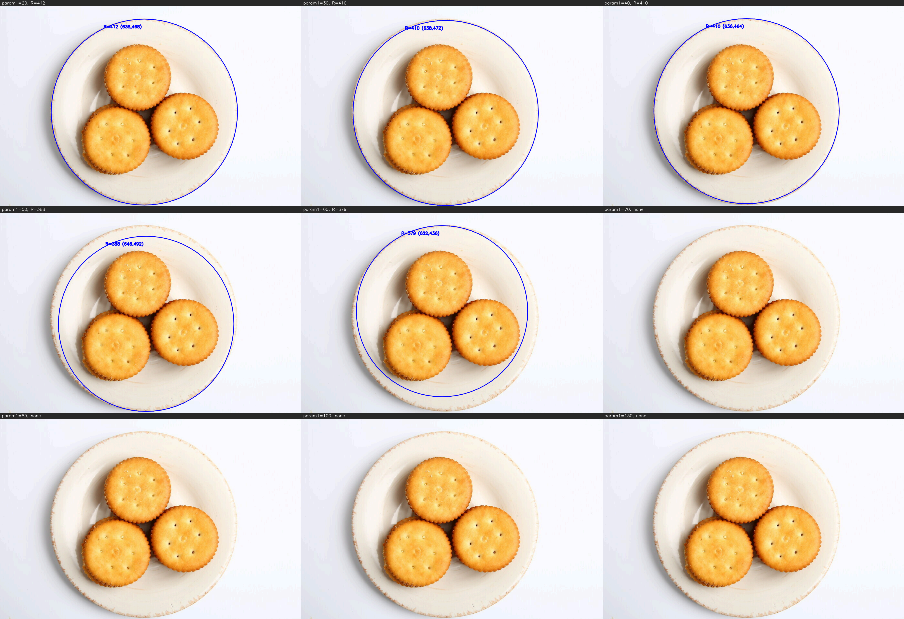
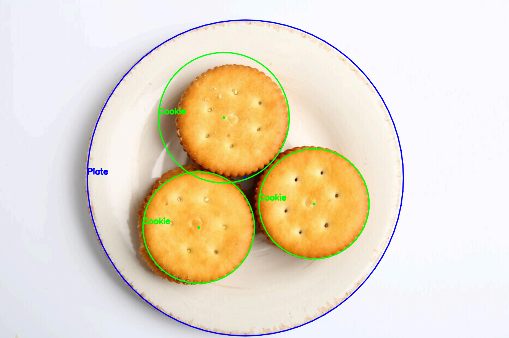
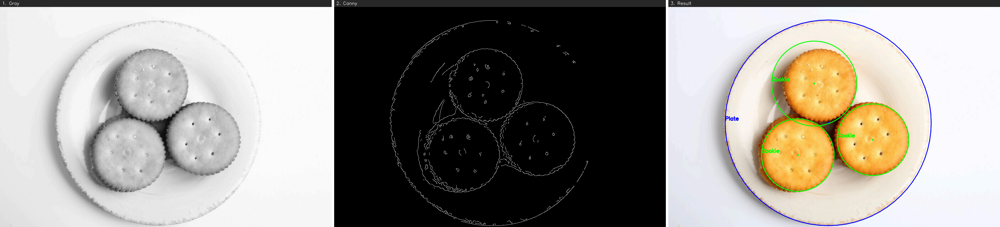
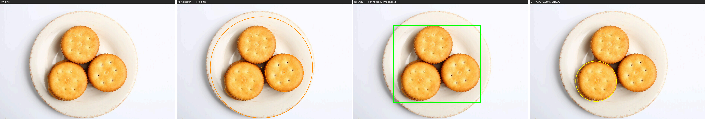
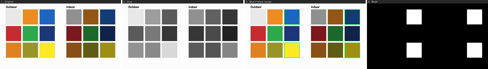
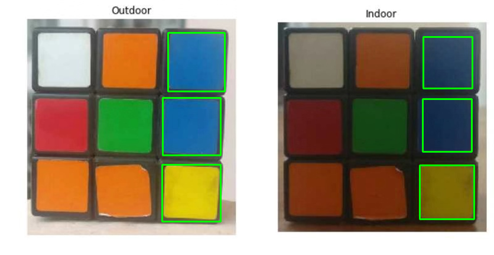
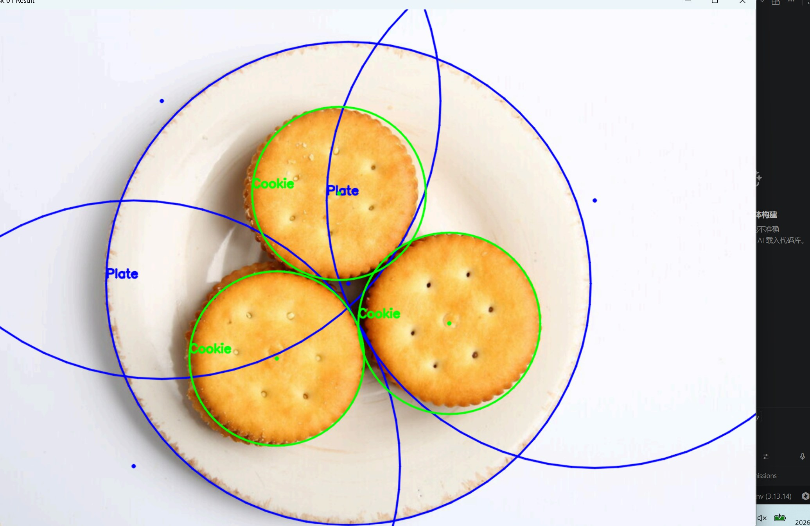
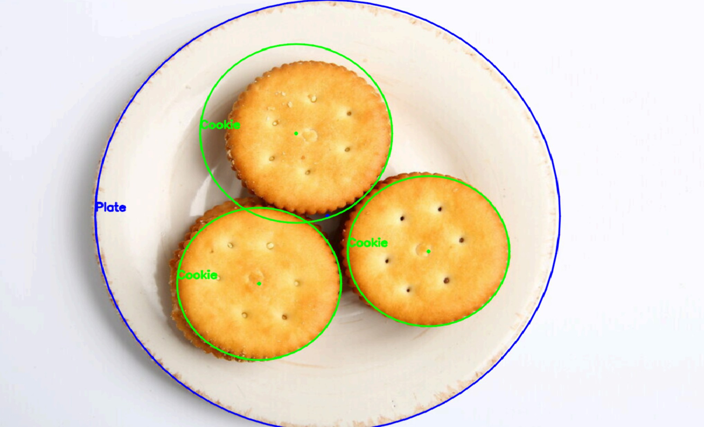
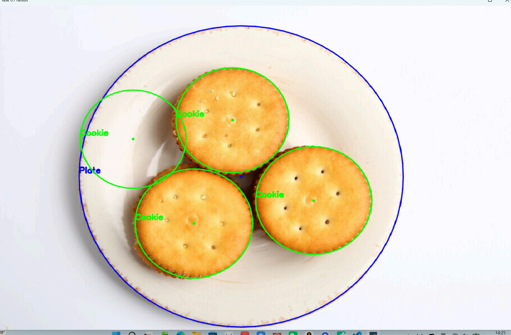
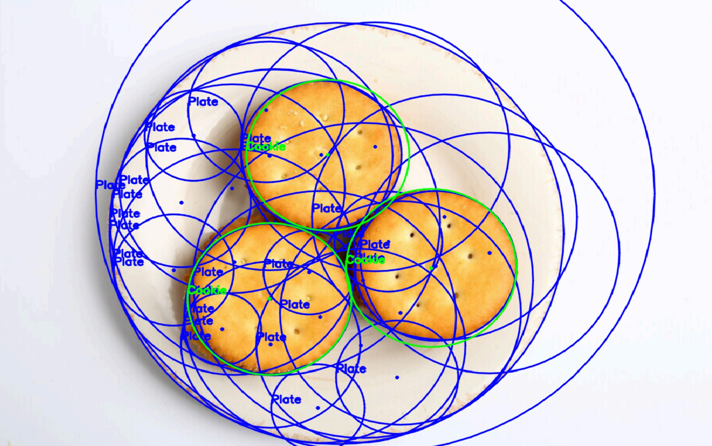

# 视觉算法组入门任务 · 学习与完成过程

> 文中所有数字都是**在真实作业原图上实测**的，可用 `extras/` 下的脚本复现。
> 文档的价值在「怎么想、怎么试、怎么解决」，不在结果图多漂亮。

> 提交人：李香君
> 仓库地址：（填你自己的仓库链接）
> 使用语言 / 环境：Python 3.13 + OpenCV 4.11.0 + VS Code

---

## 写在前面：一个零基础的人是怎么开始的

接到任务时，我以为这是「当天做完」的活。我完全没碰过 OpenCV，连 `cv2` 是什么都不知道，
题目里的「霍夫圆」「HSV 提取」对我来说只是两个陌生名词。

所以最开始我没有按顺序学，而是**两条线同时推进**：

- **一条线读概念**：把任务书拆成三个问题——什么是霍夫圆、什么是 HSV、什么是掩膜。
  查清一个，就回到题目上看它对应哪一步。
- **另一条线要代码**：先拿到一版能跑的代码，再对着它逐行理解在干什么。
  这样做的好处是**先看到全貌**，代价是很多行我只是「认得」，并没有真懂。

后来发现时间比预想宽裕，我才把节奏改过来：不再追「能不能跑通」，改成追「这一步为什么这么做」。
转折点是意识到**两个任务其实是同一条流水线**：

```
读图  →  预处理  →  提取目标  →  过滤噪声  →  标注输出
```

- 任务一：转灰度 → 霍夫投票 → 半径范围 + 票数门槛 → 画圆
- 任务二：转 HSV → `inRange` → 面积过滤 → 画矩形框

把这五步立起来之后，所有报错和调参都变成同一个问题：**我现在卡在第几步？**

| 现象 | 大概率卡在 |
|---|---|
| 程序直接崩 | 第 1 步：路径、中文名、解释器 |
| 一个都检不出来 | 第 3 步：阈值太严、半径范围不对 |
| 检出一堆假的 | 第 4 步：门槛太松 |
| 圈歪了、框大了 | 第 2 步：预处理不够，或者过头了 |

这份文档剩下的部分，就是沿着这五步，把每一步「为什么这么做、试过什么、错在哪里」写清楚。

---

## 0. 任务与结论速览

| 任务 | 要求 | 我的做法 | 结果 |
|---|---|---|---|
| 一(1) | 用霍夫圆检测找出图中的圆并标注 | `cv2.HoughCircles`，分「盘子」和「饼干」两遍，各配一套参数 | 盘子 1 个（R=409，压在盘沿上），饼干 3 个（R=148~155），全部命中 |
| 一(2) | 还有没有别的方式识别圆 | 轮廓+拟合圆、Otsu+连通域、ALT 版本三种，横向对比 | **只有霍夫 4 个目标全中**，三种替代方法合计只命中 3 个（见 §3.2） |
| 二(1) | 读图、显示、转灰度、同时显示 | `imread` → `cvtColor` → 并排拼图显示 | `results/task2_original_and_gray.png` |
| 二(2) | HSV 提取蓝色和黄色，矩形框标注 | `cvtColor(BGR2HSV)` + `inRange` + 形态学 + `boundingRect` | 蓝 4 块、黄 2 块 |

原图：`images/plate_real.png`（1333×886）、`images/chart_real.png`（836×431）。

---

## 1. 环境配置

### 1.1 走过的弯路

一开始我以为「装 OpenCV」就是去 GitHub 下载源码包。下了 OpenCV 4.5 的源码之后才发现，
那是 **C++ 用的库**，要用 CMake 编译，而且编完了和 Python 的 `import cv2` 毫无关系。
后来才搞清楚这是两条完全不同的路：

| 路线 | 装什么 | 命令 / 方式 | 适合 |
|---|---|---|---|
| Python | `opencv-python` 这个 pip 包（已编译好） | `pip install opencv-python` | 本作业、快速验证算法 |
| C++ | OpenCV 源码 + CMake 自己编 | 下载源码 → CMake → 编译 1~2 小时 | 船上的正式嵌入式程序 |

教程用 Visual Studio 是因为它讲的是 C++（VS 自带 MSVC 编译器）。
我用 Python，所以 VS Code + pip 就够了。

### 1.2 最终环境

```bash
python -m venv .venv
.venv/Scripts/python.exe -m pip install -r requirements.txt
```

`requirements.txt` 锁了版本：

```
opencv-python==4.11.0.86
numpy>=1.26
```

**为什么要锁版本**：我一开始装的是最新的 `opencv-python 5.0.0.93`（预发布版），
然后用一个纯白圆做冒烟测试，`HoughCircles` 竟然返回 `None`——一个圆都检不出来。
换成 4.11.0.86 之后，同一个测试立刻检出 `圆心(100.5, 101.5) 半径 58.3`（真值 60）。

```python
# 冒烟测试：画一个已知半径的圆，看能不能检回来
img = np.zeros((200, 200, 3), np.uint8)
cv2.circle(img, (100, 100), 60, (255, 255, 255), -1)
g = cv2.GaussianBlur(cv2.cvtColor(img, cv2.COLOR_BGR2GRAY), (5, 5), 1)
# 4.11 的结果：[[100.5 101.5 58.3]]    5.0 预览版的结果：None
```

这件事让我记住：**跑不通不一定是我的代码错，也可能是版本问题**，
所以要先用「最小可复现例子」把变量隔离开。

**【我的截图】**：VS Code 里选解释器为 `.venv` 的截图、`import cv2` 打印版本的截图。

---

## 2. 任务一(1)：霍夫圆检测

### 2.1 霍夫圆到底在干什么

一句话：**每个边缘点都在投票，得票最多的那个圆就是答案。**

盘子上有一条边。对这条边上任意一个点，我们并不知道它属于哪个圆——
它可能是半径 150 的饼干边缘，也可能是半径 380 的盘子边缘。
于是每个点都做一件很笨的事：把所有「我可能属于的圆」各投一票。
一条真实的圆形边缘上，所有点的票会集中在同一个圆上；
而饼干表面的小孔、盘子上的花纹产生的假边缘，票是散的。
最后数票，超过门槛的就算检出。

理解了这个，参数就好懂：

| 参数 | 含义 | 调大的后果 |
|---|---|---|
| `dp` | 累加器分辨率，1 = 和原图同精度 | 变大→更快但圆心更粗糙 |
| `minDist` | 两个圆心之间至少隔多远 | 太大→相邻的饼干被合并吃掉；太小→同一个圆重复检出 |
| `param1` | Canny 边缘检测的高阈值 | 太大→边缘太少，圆边缘断裂；太小→满图都是假边缘 |
| `param2` | **投票门槛** | 太大→真圆也被毙掉（漏检）；太小→到处是假圆（误检） |
| `minRadius` / `maxRadius` | 只找这个范围内的圆 | 范围放太宽→大圆把票抢走，小圆检不出来 |

### 2.2 为什么先转灰度、再高斯模糊

- **转灰度**：霍夫圆只看「明暗突变」，颜色对它没用，三通道转一通道还能快 3 倍。
- **高斯模糊**：饼干表面有小孔、盘子上有花纹，每一处都是一圈边缘，都会参与投票。

模糊到底有没有用？我固定 `param1=50, param2=25`，只改模糊核大小，实测：

| 模糊核 ksize | 检出结果 |
|---|---|
| 1（不模糊） | **13 个**：真饼干 3 个 + 10 个假的（饼干表面孔洞、盘子花纹） |
| 3 | 4 个：真 3 个 + 1 个 R=134 的假圆 |
| 5 | 3 个 |
| **9（采用）** | **3 个，R=149 / 155 / 148，最准** |
| 15 / 21 | 3 个，但半径偏到 171 / 146 / 144（边缘被糊钝了） |

结论：模糊的真实作用是**压掉小结构、让边缘变干净**。
不模糊会多出 10 个假圆，模糊过头半径又失准，`(9,9)` 是中间的平衡点。

### 2.3 关键决定：为什么分成两次检测

先说走过的错路。第一版我图省事，只调用一次，半径范围放到 `0.08~0.60` 想一把梭：

| param1 | param2 | 检出结果 |
|---|---|---|
| 50 | 25 | **21 个**：3 块饼干 + 1 个盘子 + 17 个假圆 |
| 50 | 30 | 13 个 |
| 60 | 30 | 8 个 |
| 50 | 40 | 4 个，但其中 1 个是 R=321 的假圆，且只检出 2 块饼干 |

一遍全检完全失控。原因是两类目标的尺寸差太多，**半径范围必须放得很宽**，
而宽范围给了假圆大量机会（盘子内部的阴影、饼干之间的空隙都会凑够票数）。

于是拆成两遍，每遍只管自己的半径区间和阈值：

```python
# 第一遍：找盘子。半径 0.35~0.55 倍短边，param1=60、param2=20
plates = hough_circles(blur, dp=1.0, min_dist=short*0.50, param1=60,
                       param2=20, r_min=short*0.35, r_max=short*0.55)

# 第二遍：找饼干。半径 0.09~0.20 倍短边，阈值降到 50
cookies = hough_circles(blur, dp=1.0, min_dist=short*0.16, param1=50,
                        param2=25, r_min=short*0.09, r_max=short*0.20)
```

**限制半径范围，等于提前告诉算法「我只找这么大的东西」**，
比事后靠阈值筛选可靠得多。这也是「一遍」和「两遍」最本质的差别。

顺带一个坑：第二遍的 `minDist` 必须小于三块饼干的圆心距（实测约 300 像素），
否则相邻的饼干会被当成同一个而漏掉。

用「倍数」而不是写死的像素值，换分辨率不同的图也不用改代码。

### 2.4 调参记录

**盘子的 param1 扫描**（`param2=20`、半径 0.35~0.55）：

| param1 | 检出结果 | 边缘命中率 | 说明 |
|---|---|---|---|
| 20 | (638,468) R=412 | 54% | 外沿，半径略大 |
| 30 | (638,468) R=412 | 54% | 同上 |
| 40 | (634,468) R=415 | 30% | 半径偏大，命中率骤降 |
| 50 | (634,468) R=415 | 30% | 同上（**不单调**） |
| **60** | **(638,472) R=409** | **52%** | **采用** |
| 70 | (638,472) R=409 | 52% | 与 60 一致，可用 |
| 85 | (630,468) R=406 | 38% | 开始偏移 |
| 100 / 130 | 没检出 | — | 边被滤光 |

**盘子的 param2 扫描**（`param1=60`）：

| param2 | 检出结果 | 边缘命中率 | 说明 |
|---|---|---|---|
| 10 | 4 个：(638,468) R=413 + 3 个 R=454~475 | 真圆 54%，假圆 8~11% | 假圆圆心在图角，明显不在盘子上 |
| 15 / **20** / 22 | **(638,472) R=409** | **52%** | **采用，正好压在盘沿上** |
| 25 | (632,470) R=409 | 44% | 半径对，但圆心开始偏 |
| 30 | (622,436) **R=379** | **16%** | ⚠️ **这是盘子的内圈，不是外沿** |
| 35 / 40 | 没检出 | — | 门槛过高 |

### 2.4.1 AI 把内圈当成了盘子，是我看出来的

这一节记一次**我没照抄 AI 结论**的经历，它是这份作业里我最在意的一段。

AI 一开始用 `param2=30` 跑，得到 `(622,436) R=379`，并且把这个结果**当成了盘子半径的真值**——
后面所有"偏差多少像素"的对比，都是拿这个 379 当基准算的。这是个循环论证：
拿自己跑出来的结果当标准答案，就永远错不了。

我把它给的图放大看，觉得不对：`param2=20` 那个圈是**压在盘沿和桌面的交界上**的，
而 `379` 那个圈落在盘子内部那一圈光滑斜面上，那里根本没有边。

提出来之后，AI 用了一个客观指标重新判——**边缘命中率**：
沿圆周取 360 个点，看每个点沿半径方向 ±4 像素内是否存在强梯度，统计命中的比例。

```
R=379 → 命中率 16%   ← 圆周大部分压在光滑斜面上
R=409 → 命中率 52%   ← 圆周大部分压在真正的盘沿上
```

所以 `R=409` 才是对的，`param2` 从 30 改成 20。

为什么门槛一高就只剩内圈？因为**盘子的外沿比内圈更模糊**：外沿是白瓷对浅色桌面，
灰度差只有十来个灰阶；内圈是白瓷对白瓷的折角，对比反而更强一点。
门槛提高时先被淘汰的是弱边，于是外沿先死，内圈"胜出"。

这件事给我两个教训：

1. **「看着标准」不是判据。** 圈画在圆盘上，稍微大一点小一点都像对的。
   要么量指标（命中率），要么放大看它压在哪条边上。
2. **AI 给的默认值不能当基准。** 它给的是"某组参数下的输出"，不是"正确答案"。
   拿输出当答案，后面的所有对比都是自证。

### 2.4.2 两个参数是耦合的，不能孤立地说“某个值不行”

这一点我踩过：先按 `param2=30` 扫 `param1`，发现 `param1≥70` 一个圆都检不出，
就写下了“`param1` 不能超过 60”。

但把 `param2` 改成 20 之后重扫，`param1=70`、`param1=85` 都能正常检出 `R=409`。

所以正确表述是：

> `param1` 的可用上限**取决于 `param2`**。`param2=30` 时上限是 60；`param2=20` 时上限是 85。
> 报一个参数的“好值”必须带上另一个参数的取值，否则没有意义。

饼干那一遍同理（`param2=25`，`param1=50`）：

| param1 | 30 | **50** | 60 | 70 | 80 及以上 |
|---|---|---|---|---|---|
| 检出饼干 | 3（圆心偏 5~10px） | **3（最准）** | 3 | 1 | 0 |

**这就是必须分两遍的直接原因**：不是“两类目标的参数完全不同”，而是
半径差 2.6 倍、各自的最优 `param1` 和 `param2` 又互相牵制，
一组参数只能落在两边的妥协点上，换张照片就崩。

### 2.4.3 半径范围也不是“事后筛子”，它会改变结果

只把 `PLATE_R_MIN_RATIO` 从 `0.35` 改成 `0.20`，其它全不动：

| 半径下限 | 检出结果 |
|---|---|
| 0.35（采用） | (638,472) **R=409** |
| 0.20 | (638,468) **R=413** |

圆心几乎没动，半径大了 4 像素。原因不是“筛掉了什么”，而是**候选半径的集合变了**，
累加器里票数最高的那一档随之改变。

所以「限制半径范围」不只是过滤，它参与检测本身。定范围的原则是：
**包住真值并上下留余量**（实测 409/886 = 0.46，所以取 0.35~0.55），
而不是“反正宽一点更保险”——放太宽，结果反而会飘。



*图：`param1` 从 20 到 130（`param2` 固定为 20）。从 100 起才是全空白——
注意这张图是在 `param2=20` 下跑的，和“70 就没了”那次不是同一组条件。*

### 2.5 结果

```
读入图片：images/plate_real.png  尺寸 1333x886（短边 886）
检测到盘子 1 个：[[638, 472, 409]]
检测到饼干 3 个：[[516, 596, 149], [810, 536, 155], [622, 314, 148]]
```

三块饼干的半径 148~155，圆心分别落在盘子中部、左下、右下，和照片上的位置一致。



*图：蓝圈标盘子（R=409，正好压在盘沿上），绿圈标三块饼干（R=148~155）。*



*图：左 原图 / 中 高斯模糊后的灰度 / 右 Canny 边缘。中间那格能直接看出「盘沿的边比饼干淡多少」。*

---

## 3. 任务一(2)：还有哪些办法能识别圆

### 3.1 三种方法各自的思路

**方法 A：边缘 → 轮廓 → 拟合圆 → 偏差筛选**

先用 Canny 得到边缘，再用闭运算把断开的边连起来，然后对每条轮廓拟合一个圆，
最后用一个指标判断它「像不像圆」。

我一开始用的是教科书上的**圆度**：

```
圆度 = 4π × 面积 / 周长²        （正圆 = 1，正方形 ≈ 0.785）
```

结果**一个都筛不出来**。原因很具体：真实照片里盘子的边是断断续续的，
轮廓是**开口曲线**，`contourArea` 算出来的面积接近 0，圆度自然恒接近 0。
（我用 `Canny(40,120)` 跑，面积 > 500 的轮廓只有 0~3 条，最高圆度 0.66，够不到 0.80 的门槛。）

改成两步才跑通：

1. **筛选尺子换成周长**（`arcLength > 600`），不再用面积——开口曲线也有周长；
2. **套圆换成最小二乘拟合**（解一个线性方程组），不再用 `minEnclosingCircle`——
   后者只要有**一段**弧离得最远，半径就被撑大，对断弧很不友好。

判据改成「轮廓点到拟合圆的相对偏差」`std(d) / r`，门槛 0.10。

另外还有个坑：**同一个圆会留下两条轮廓**（外边缘一条、内边缘一条），
所以要加一步「圆心近 + 半径差不多就合并」，这个去重思路和深度学习里的 NMS 是同一类想法。

**方法 B：Otsu 二值化 → 连通域 → 外接矩形筛选**

不去找边，而是把「比背景暗的整块东西」抠出来。
Otsu 是自动找阈值的办法：遍历所有阈值，选让前景、背景差别最大的那个。
然后数连通域，用面积和长宽比筛选。

这个方法在**本图上有天然缺陷**：盘子是白的（灰度 246），桌面也是浅色（244），
两者只差 2 个灰阶，`THRESH_BINARY_INV` 切出来的是「饼干 + 阴影」这一整块，
盘子和桌面一起落在背景里。这说明它和霍夫法的根本区别：
**霍夫找的是「边缘」，Otsu 找的是「区域」。**

**方法 C：HOUGH_GRADIENT_ALT**

还是霍夫，但判据更严：要求边缘的**梯度方向**和「圆心到该点的半径方向」一致。
好处是圆心半径更准、假圆更少；代价是参数更敏感，对边缘不完整的圆会漏。

### 3.2 四种方法的实测

脚本：`extras/task1_other_methods.py`



*图：左起 —— 原图 / A 轮廓法（橙色圆）/ B 连通域（绿框）/ C ALT（黄圈）。*

目标真值：盘子 `(638,472) R=409`，饼干 `(516,596) R=149`、`(810,536) R=155`、`(622,314) R=148`。

| 方法 | 检出 | 盘子 | 饼干 | 关键参数 | 主要弱点 |
|---|---|---|---|---|---|
| **霍夫（本项目采用）** | **4 个** | ✅ R=409（命中率 52%） | ✅ 3 块全中 | 半径范围 + 两套阈值 | 参数敏感，不同尺度要分别调 |
| A 轮廓 + 拟合圆 | 2 个 | ⚠️ R=389（半径 -20px、圆心偏 18px、命中率 23%） | 1 块（右下，R=144） | Canny(20,60)、闭运算 9×9、周长≥600、偏差≤0.10 | 盘沿碎成小段时连候选都进不去；漏掉两块 |
| B Otsu + 连通域 | 1 块 | ❌ 没找到 | ❌ 0 块（三块连成一片） | Otsu 阈值 204、面积≥20000、长宽比 0.7~1.3 | 白盘子和浅色桌面只差 2 个灰阶，切不开 |
| C ALT 版本 | 1 个 | ❌ 没找到 | 1 块（左下，R=155） | `dp=1.5`、`param1=50`、`param2=0.3` | 判据严，边缘不完整就漏；`param1` 给官方示例的 300 时本图** 0 检出** |

四条实测结论：

1. **霍夫是唯一 4 个目标全中的**，原因是它的投票机制**不要求边缘闭合**。
   A 方法要求边缘能连成一条可拟合的长弧，B 要求目标比背景暗，C 要求梯度方向严格一致，
   这三条在本图上都不成立。这就是最后选霍夫的理由——不是它「更先进」，是它更耐残缺。
2. **A 的失败点不在「套圆」，在「筛子」。** 同一批轮廓，用外接圆 + 圆度筛选是 0 个，
   换成最小二乘拟合 + 偏差筛选就出 2 个。算法不变，换判据就活了。
3. **判“对没对”不能靠眼睛，要靠指标。** 我最初把 `R=379` 当成正确答案，因为圈在圆盘上看着很标准；
   实际它的边缘命中率只有 16%，圆压在盘子内部的斜面上。改用「沿圆周 360 个点的边缘命中率」之后，
   `R=409` 是 52%、`R=379` 是 16%，高下立判。**同一个指标也能用来比较不同方法的输出质量**，
   这比“看着像不像”客观得多。
4. **B 输出的那个 1 块是巧合**。它的框是 662×592，中心 (615,491)，看着很像盘子，
   其实那是「三块饼干 + 阴影」连成的一整块。**看数字像对，看图才知道错**——
   这也是为什么每步都要把中间结果画出来看。

### 3.3 什么时候用哪个

- 圆的边界清晰、大小已知 → **霍夫**，最直接，不需要分割；
  边缘**断开**它也能投出票来，这是它最值钱的地方。
- 边缘能连成**一条足够长的弧**、但形状被部分遮挡 → **轮廓法 + 拟合圆**，
  它只用轮廓点，弧有缺口也能拟合出圆心半径。
  （注意：弧碎成很多小段就不行了，本次实测 `Canny(40,120)` 下连候选都进不去。）
- 目标本身就是一块实心色块（比如海面上的浮标） → **连通域**，最快，
  而且顺手能算出面积、中心、颜色均值，这些霍夫给不了。
  前提是目标亮度和背景拉得开——本次的两类目标都不满足。
- 要亚像素精度 → 别用 ALT，直接**把检出的边缘点拿去做最小二乘拟合**，
  本次方法 A 里那个 `fit_circle()` 就是干这个的，偏差能压到 0.007。

再往下一类是**深度学习做分割/检测（YOLO、U-Net）**。
它不是「找圆的几何特征」，而是从样本里学「圆长什么样」，
所以光照变化、部分遮挡时会比传统方法稳，代价是要标注数据、要算力。
我的理解是：传统方法负责「快而准的几何」，深度学习负责「复杂场景的鲁棒性」。

---

## 4. 任务二：传统视觉基础

### 4.1 读图、显示、转灰度

`cv2.imread` 在 Windows 上遇到中文路径会**静默返回 None**，不报错。
第一次运行就卡在这，报错是：

```
AttributeError: 'NoneType' object has no attribute 'shape'
```

看着像「图片没属性」，实际是「图片根本没读进来」。解决办法是先当二进制读，再解码：

```python
img = cv2.imdecode(np.fromfile(path, dtype=np.uint8), cv2.IMREAD_COLOR)
```

**灰度为什么重要**：三通道 → 单通道，数据量降到 1/3，
而且边缘、轮廓、霍夫这些几何算法根本不需要颜色信息。

### 4.2 为什么颜色提取不用 RGB 而用 HSV

RGB 的三个通道都是「有多亮」，颜色和亮度是**混在一起**的。
同一个蓝色，太阳底下和阴影里三个数全变，范围根本写不全。

HSV 把它拆开：

- **H 色相**：是什么颜色（OpenCV 里压缩到 0~179）
- **S 饱和度**：颜色有多浓（0 是灰，255 最艳）
- **V 明度**：有多亮（0 是黑）

拆开之后，「是不是蓝色」只看 H 就够了。真实色卡上的实测值：

| 色块 | HSV | 说明 |
|---|---|---|
| Outdoor 亮蓝（顶行） | H=103 S=228 V=173 | 目标蓝 |
| Outdoor 亮蓝（中行） | H=103 S=225 V=170 | 目标蓝 |
| **Indoor 蓝（顶行）** | **H=106 S=152 V=94** | 目标蓝，但**又暗又淡** |
| Indoor 蓝（中行） | H=106 S=185 V=77 | 同上 |
| Outdoor 黄 | H=27 S=245 V=224 | 目标黄 |
| Indoor 黄 | H=25 S=249 V=127 | 目标黄，偏暗 |
| 橙 | H=14 S=237 V=225 | H 不在蓝/黄区间，天然排除 |
| 白块 | H=20 S=14 V=236 | S 很低，靠 S 下限排除 |
| 灰块 | H=20 S=44 V=128 | 同上 |

这张表说明 `inRange` 三个数的分工：**H 决定「是什么颜色」，S 和 V 决定「够不够纯、够不够亮」**。

### 4.3 掩膜 + 形态学

`inRange` 出来的是黑白掩膜：落在范围内的像素 255，其余 0。
直接画框会有零碎白点和内部黑洞，所以做两步形态学：

- **开运算**（先腐蚀后膨胀）：去掉孤立的小白点
- **闭运算**（先膨胀后腐蚀）：补上内部的小黑洞

再 `findContours` + `boundingRect` 拿到矩形，画框写字。

### 4.4 S 下限定在哪里（这次最有意思的发现）

关键矛盾：**同一张照片里，Outdoor 和 Indoor 的光照差了一倍。**

- Outdoor 的蓝：S=225~228
- Indoor 的蓝：S=**152~185**

如果为了让颜色「更纯」把 S 下限抬到 205，Outdoor 的 4 块里能保住，
但 Indoor 那两块的 S 只有 152 和 185，**直接被切掉**：

```
S≥120 → 蓝色 4 块  （两个面板各 2 块，全中）
S≥205 → 蓝色 2 块  （只剩 Outdoor，Indoor 整组丢失）
```

而黄色那边，两个色块的 S 都到 240 以上，S 下限给多少都不影响。

所以最后的判断是：**这张图里 H 已经足够区分「蓝/黄/橙/白」，
S 只该用来排除「白和灰」（S=14、44），不该用来筛「纯不纯」**。
S 下限取 120，留足余量。

**这就是传统视觉最典型的坑：阈值是按某一块区域调出来的，换个光照就失效。**
同一张图里，左半边和右半边光照都不一样。
真要解决，得靠「自适应」——比如先用白平衡做光照归一化，
或者不用固定的 V 阈值，改用「同区域内相对亮度」来判断。



*图：左起 —— 原图 / 灰度 / 绿色矩形标注 / 掩膜。*



---

## 5. 我亲手做的实验记录

前面几节是「结论」。这一节记的是「怎么得出结论的」——每个实验都只改一个参数，其它全不动。

这一步的价值在于：**参数不是查来的，是试出边界来的。** 知道「9×9 好用」和知道「9×9 为什么好用、
15×15 会坏在哪里」，是两回事。

### 5.1 一次调用检测全部：屏幕上出现 26 个圆

把半径范围放到 `0.08~0.60`、`minDist` 放到 `0.10`，让一次 `HoughCircles` 同时找盘子和饼干。



屏幕上密密麻麻全是蓝圈，「Plate」标签叠在一起完全看不清。实测检出 **26 个**，
其中只有 4 个是真的：

| 真圆（4 个） | 假圆（22 个） |
|---|---|
| 盘子 R=413<br>饼干 R=146 / 147 / 148 | R=309、300、247、224、211、203、194…… |

假圆全部来自**盘子内部的一圈圈圆弧**和**饼干之间的空隙**。

**结论**：一次调用失败，原因不是参数没调好，而是从原理上就不可能同时满足——
票数门槛是一把尺子，大半径候选天生多、票数天生高，小目标必然被压掉。
这就是必须分两遍（甚至更多遍）检测的直接原因。

### 5.2 `param2` 提高之后，圈住的不是外沿而是内圈

`param2` 从 20 提到 30，同一个盘子会得到两个不同的圆：



这张图里的蓝圈**看起来相当标准**——圈在圆盘上，不仔细看挑不出毛病。
但它压在盘子内部那一圈斜面上，那里没有任何边界。

| param2 | 结果 | 边缘命中率 |
|---|---|---|
| **20（采用）** | (638,472) **R=409** | **52%** |
| 30 | (622,436) R=379 | 16% |

**结论**：正圆这个形状本身提供了"看起来对"的假象，**必须靠指标或放大图才能判断圈得准不准**。
这一段是 §2.4.1 那次纠错的现场记录。

### 5.3 门槛放松，空白处也会长出圆



注意盘子左边那片空白——那里什么都没有，却多了一个绿圈和「Cookie」标签。

**结论**：`param2`（票数门槛）和 `minDist`（圆心最小间距）是两道闸。
闸一松，边缘上的噪点凑够票数就能成为一个"圆"。
**宁可漏检也不能误检**（漏了能发现，误了会当成结果），所以这两个参数应该压着往下调。

### 5.4 模糊核调大，半径会被"撑大"



三个绿圈都比饼干本身大了一圈。把 `BLUR_KSIZE` 从 `(9,9)` 往上调就是这个效果：

| ksize | 饼干的半径 |
|---|---|
| (3, 3) | 147, 143, 149, **134** ← 多出一个假圆 |
| (5, 5) | 149, 149, 146 |
| **(9, 9)** | **149, 155, 148** ← 最接近真实值 |
| (15, 15) | 146, 144, **171** ← 偏了 20 像素 |
| (21, 21) | 146, 144, **171** |

**两头都错，但错法完全不同**：

- 核太小 → 饼干表面的气孔变成假边缘，多长出一个圆；
- 核太大 → 饼干的外沿被糊开，梯度峰值往外移，拟合出的半径跟着变大。

**结论**：模糊不是"越糊越干净"。它要正好把细节抹掉、又不能把目标边界抹掉，
所以必须和目标的尺寸比着调。饼干的气孔只有 2~4 像素，用 9 就够，用 15 就过头了。

### 5.5 任务二的阈值：两端都是硬边界

任务一里把半径下限从 0.35 改到 0.05，结果只是半径从 409 漂到 413；但任务二不能这么玩。

**蓝色 S 下限**（只改 `BLUE_LOWER` 中间那个数）：

| S 下限 | 蓝块数 | 现象 |
|---|---|---|
| 40 | 3 | Outdoor 顶行和中行**粘成一块**（外接框 h=211，正常每块 ≈100） |
| 90 ~ 150 | **4** | 正常 |
| 180 | 3 | Indoor 开始缺 |
| 240 | 0 | 一块都不剩 |

**黄色 V 下限**：

| V 下限 | 黄块数 | 现象 |
|---|---|---|
| 70 ~ 90 | **2** | 两块都完整（掩膜占外接框 96%） |
| 120 | 2 | 块数没变，但 Indoor 那块**缺了四分之一像素**，掩膜形状残缺 |
| 180 | 0 | 连 Outdoor 也一起切掉 |

**结论**：任务一改的是「允许多大范围」，任务二改的是「什么算目标」。

- 范围放宽，只是多了些候选，真值票数最高，结果几乎不动；
- 判据放宽，**不该进来的东西也进来了**——低饱和度像素把两个色块连成一片，
  于是块数反而**变少**（4 块变 3 块），这跟直觉正好相反。

### 5.6 六个实验合成一张表

| 参数 | 可用区间 | 越界会怎样 |
|---|---|---|
| `PLATE_CANNY_HIGH` | 20 ~ 60（`param2=30` 时） | 低了半径偏大；70 起边缘被滤光，归零 |
| `PLATE_PARAM2` | 20 ~ 25 | 30 只找到内圈；35 归零 |
| `PLATE_R_MIN/MAX_RATIO` | 下限 0.05~0.45、上限 ≥0.50 | 下限影响小（漂 4px）；上限低于真值直接归零 |
| `BLUR_KSIZE` | 5 ~ 9 | 3 出假圆；15 以上半径偏 20px |
| `BLUE` 的 S 下限 | 90 ~ 150 | 40 两块粘连；180 起掉块 |
| `YELLOW` 的 V 下限 | 70 ~ 90 | 120 切掉 Indoor 四分之一像素 |

这张表就是"调参"这件事的全部产出：**每个参数没有"正确值"，只有"可用区间"和"两端的坏法"。**

---

## 6. 遇到的问题清单

| 现象 / 报错原文 | 原因 | 怎么解决的 |
|---|---|---|
| `ModuleNotFoundError: No module named 'cv2'` | OpenCV 装在了另一个 Python 环境里 | 给项目单独建 `.venv`，VS Code 里选这个解释器 |
| `No matching distribution found for opencv-python` | pip 走清华镜像，当时没同步这个包 | 换回官方源 |
| `HoughCircles` 返回 `None`，一个圆都检不出 | 装到了 5.0.0.93 预览版 | 锁回 `4.11.0.86` |
| `SyntaxError: '(' was never closed` | 参数太多换行写，行尾忘了补 `)` | 补上括号；参数多时换行记得闭合 |
| `TypeError: unsupported operand type(s) for *: 'type' and 'float'` | 写了 `np.short * 0.5`，而 `np.short` 是一种**类型**不是数值 | 应该用变量 `short`（短边长度） |
| `ValueError: The truth value of an array ... is ambiguous` | 对 numpy 数组写了 `if not circles` | 改成 `if len(circles) == 0` |
| `AttributeError: 'NoneType' object has no attribute 'shape'` | 中文路径导致 `imread` 返回 None | `np.fromfile` + `imdecode` |
| 图上中文标签变成 `???` | `cv2.putText` 只支持 ASCII | 标签全改英文 |
| 一个圆被画了两遍（轮廓法出 9 个圆） | 圆的里外两条边各是一条轮廓 | 按「圆心近 + 半径近」去重 |
| 轮廓法一个圆都筛不出（最高圆度只有 0.66，门槛 0.80） | 盘沿是断的，开口曲线算不出面积，圆度恒接近 0 | 筛选用**周长**代替面积，判据换成「拟合圆偏差」 |
| `minEnclosingCircle` 给的半径比真值大 40~50px | 只要有一段弧离得最远，外接圆就被这一个点撑大 | 改用**最小二乘拟合圆**，偏差压到 0.007 |
| ALT 版本一个圆都检不出 | `param1` 照官方示例给了 300，本图边缘太弱 | 降到 50，`param2` 给 0.3，检出 1 块 |
| 检出的圆「看着很标准」，其实是盘子的内圈 | `param2=30` 门槛偏高，外沿（对比更弱）先被滤掉，只剩内圈 R=379 | 降到 `param2=20` 得到外沿 R=409；并用「边缘命中率」验证（16% → 52%） |
| 同一次 `param1=70` 一会儿能检出一会儿检不出 | 它和 `param2` 耦合：`param2=30` 时 70 就失效，`param2=20` 时 85 还能用 | 记录参数时必须成对写，不能只说“某个值不行” |

---

## 7. AI 是怎么用的

先说清楚实际情况，不含糊：**代码主体是 AI 写的**，不是我手敲的。

我的用法是「让它写出来，然后逼自己读懂每一行」，具体分四步：

1. **逐行拆解**。看不懂的写法就单独问，比如 `contours, _ = cv2.findContours(...)`
   里的 `_` 是什么、`np.short * 0.5` 为什么报 `TypeError`、
   `img[y, x]` 为什么不是 `img[x, y]`。这一类问题问了几十个，
   拆完再看代码，句式基本是重复的。
2. **让它解释「为什么」，而不是只给改法**。比如 `param1` 到底是 Canny 的哪个阈值、
   `minDist` 为什么两遍取不同值、HSV 为什么能抗光照但抗不了明暗。
   这些解释我都在真实图上验证过才写进文档。
3. **环境是自己趟出来的**。`cv2` 装进了另一个 Python、PowerShell 执行策略拦住
   `Activate.ps1` 导致虚拟环境一直没激活、中文路径下 `imread` 静默返回 `None`——
   这三件事 AI 一开始也没想到，是一个个报错撞出来的（见 §6）。
4. **参数和结论以实测为准**。§2.4、§3.2 里的每个数字都来自 `extras/` 和主程序的
   实际输出，可以复现；凡是实测和「书上说法」冲突的，一律按实测写
   （比如轮廓法的圆度筛选在本图完全失效、ALT 的 `param1` 不能照抄官方示例）。
5. **AI 的结论也要验证，尤其是它自己跑出来的数**。它一开始把 `param2=30` 得到的
   `R=379` 当成盘子半径的真值，后面所有「偏差多少像素」都拿这个数当基准——
   等于拿自己的输出当标准答案，怎么比都是对的。
   是我把两张结果图放大对比，发现 379 那个圆压在盘子内部的斜面上，它才改用
   「边缘命中率」重新判（16% vs 52%，见 §2.4.1）。
   **这件事的教训比任何一条参数都重要：AI 给的是「某组参数下的输出」，不是「正确答案」。**

**我没做到的**：没有从零手写过一遍完整实现。这是这份作业的遗憾，
如果重来一次，我会先照骨架自己写一版能跑的，再让 AI 逐行挑问题。

---

## 8. 参考资料

- OpenCV 官方文档 · HoughCircles：https://docs.opencv.org/4.x/dd/d1a/group__imgproc__feature.html#ga47849c3be0d0406ad3ca45db65a25d2d
- OpenCV 官方文档 · 颜色空间转换：https://docs.opencv.org/4.x/de/d25/imgproc_color_conversions.html
- OpenCV 官方文档 · 形态学操作：https://docs.opencv.org/4.x/d9/d61/tutorial_py_morphological_ops.html
- 组里给的 OpenCV 基础教程（B 站）
- 《提问的智慧》精简版
